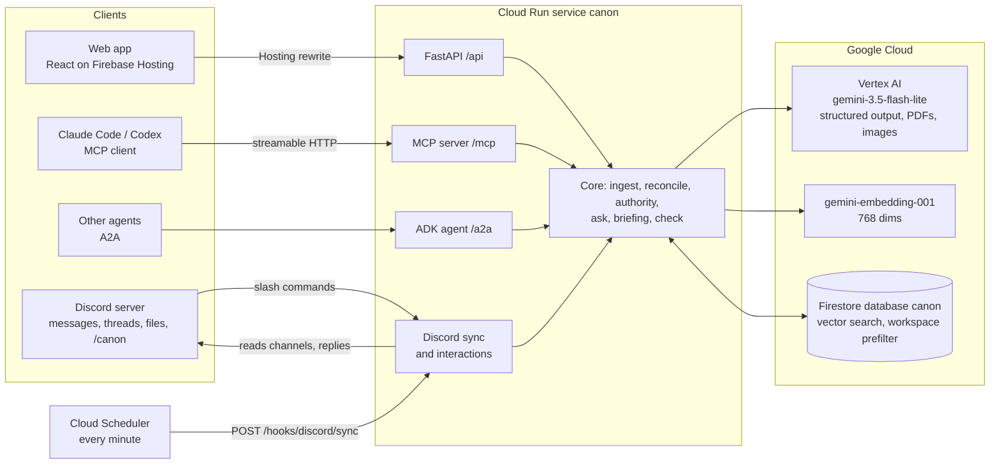

<p align="center"></p>

# Canon

**The shared memory of a company, for its people and its AI agents.**

## For judges: try this in two minutes

No login, no setup. Open https://canon.tn07.dev and follow these steps.

| # | Do this | What you should see |
|---|---|---|
| 1 | Open **[New hire](https://canon.tn07.dev/new-hire)**. | A red warning that the Release process wiki is out of date, with the old line and the newer decision side by side. |
| 2 | Open **[For agents](https://canon.tn07.dev/agent)**. Under "Try it yourself", type `Add a cron job that deploys the dispatch service to production every Friday at 15:00`. | The verdict **Block**, with the Friday deploy ban, its owner and the incident behind it. |
| 3 | Open **[Paste](https://canon.tn07.dev/paste)**. Click the sample **Friday deploy job**, then **Check this message**. | The conflict with the Friday ban, and the stale Release process wiki, in a few seconds. |
| 4 | Open **[Ask why](https://canon.tn07.dev/ask)**. Ask `What's our tech stack?` or `Why did we choose Postgres?`. Then ask `What is Northwind Labs annual recurring revenue for 2026?` | Short answers with verified quotes. For the revenue question, Canon says it does not know. It does not guess. |
| 5 | Join the Discord server https://discord.gg/HwSgjmcgF5 and post in **#engineering**, for example `lets ship the dispatch cron this friday`. | Canon replies under your message within about a minute, with the decision it breaks. |

Proof links: [GitHub repo](https://github.com/tejasnafde/canon) · [Firebase Hosting](https://canon-tn07.web.app) · [Cloud Run health](https://canon-ezvux7gqxa-el.a.run.app/health) · [MCP endpoint](https://canon.tn07.dev/mcp) · [How well does it work](https://canon.tn07.dev/benchmark)

**Built on Google Cloud:** Gemini on Vertex AI (extraction, checks, answers, embeddings), Firestore (the decision record), Cloud Run (API, MCP and A2A in one service), Firebase Hosting (the web app), Cloud Scheduler (Discord sync every minute), ADK and A2A (the agent interface).

Teams decide things in Slack threads, meetings and pull requests, then forget. New hires follow a wiki page that was overruled months ago. Coding agents ship changes that break a rule nobody wrote into the code.
Canon keeps one record of every decision and the reason behind it. Each decision is backed by a quote that is checked word for word against its source. Canon checks every new message, document and agent action against that record, and it warns when a person, a document or an AI agent is about to break a decision.

Built by team **Localhost** (Tejas Nafde, Ishank Giri, Mitushi) for the Google Cloud AI Builder Cup 2026, track "Future of Work & Enterprise Productivity".

## Live links

| What | URL |
|---|---|
| Web app | https://canon.tn07.dev |
| Same app on Firebase Hosting | https://canon-tn07.web.app |
| Cloud Run service (health check, no Gemini) | https://canon-ezvux7gqxa-el.a.run.app/health |
| MCP endpoint (streamable HTTP) | https://canon.tn07.dev/mcp |
| A2A agent card | https://canon.tn07.dev/.well-known/agent-card.json |
| Public Discord demo server | https://discord.gg/HwSgjmcgF5 |

There is no login. Each browser gets its own private workspace, so judges do not see each other's pastes.
Cloud Run scales to zero, so the first request after a quiet period can take a few seconds more.

All company data is synthetic. "Northwind Labs" is a made-up 60-person logistics software company. Canon read 380 of its sources (Slack, meetings, wiki, pull requests, commits, email) from January 2025 to October 2026. See `data/README.md`.

## Try it in 2 minutes

Open https://canon.tn07.dev. Home shows the live counts (380 items read, 345 official decisions, 27 documents now out of date) and four stories.

1. **I am new here.** Click it. You see "Welcome to Northwind Labs.", a red warning that one handbook page is out of date (with the old line and the newer decision side by side), "5 things you must know", and "People to ask" with their topics.
2. **What changed while I was away?** Pick **Engineer**, then **Sales**. The summary and the to-do list change with the role, most urgent first, each item with a score and its reasons. Canon has 14 roles.
3. **Watch an AI agent get stopped.** A coding agent asks Canon before it adds a Friday deploy job. The verdict is **Block**, with the rule "There will be no production deployments on Fridays, which includes scheduled jobs and configuration-only releases.", the owner (Mei Tan), the date (9 March 2026) and the incident behind it. Below it, the same exchange as the agent saw it.
4. **Paste a new message.** Pick the sample **Friday deploy job** (or paste the text below) and click **Check this message**. Canon extracts the decision, verifies the quote, and shows what it goes against: the Friday ban, and the out-of-date Release process wiki.

   ```
   Pranav: I have scheduled the production dispatch image refresh for every Friday at 15:00 Singapore time. It runs unattended, including configuration changes. I used the slot from the Release process wiki. This is routine housekeeping, not incident mitigation.
   ```

5. **Ask why.** Ask `Why can we no longer deploy production on Fridays?` You get a short answer, a timeline (the old Friday window, then the INC-042 ban) and verified quotes.
   Then ask `Which company acquired Northwind Labs?` Canon says "I do not know. The record has no decision or document that answers this." It does not guess.
6. **People.** The org tree: who reports to whom, who left, and who took over their topics. Open a person to see the decisions they own.
7. **Discord, live.** Join https://discord.gg/HwSgjmcgF5 and post in **#engineering**:

   ```
   lets ship the dispatch cron this friday
   ```

   Wait about a minute. Canon reads the server every minute, replies under your message with the decision it breaks, and the alert appears on the web app. You can also use `/canon ask`, `/canon check`, `/canon catchup` and `/canon remember`.
8. **How well does it work?** The benchmark and the memory-health replay (numbers below).

More inputs: two more paste samples (an update and a new decision) in `data/samples/live_paste.json`, one example per MCP tool in `data/samples/agent_playground.json`, and these questions:

- What's our tech stack?
- Why did we choose Postgres?
- How do we deploy to production?
- Who approves access to the production database?
- What should we quote a new Route Lens customer, and why did the price change?
- When did Route Lens GA move, and what gate held it up?
- What is Northwind Labs annual recurring revenue for 2026? (Canon refuses: the record has no answer)

## Connect your agent

Canon is an MCP server. Any MCP client can read the record and check an action before it acts.

Claude Code:

```sh
claude mcp add --transport http canon https://canon.tn07.dev/mcp
```

Codex:

```sh
codex mcp add canon --url https://canon.tn07.dev/mcp
```

Then ask your agent: "Add a GitHub Actions cron that deploys the dispatch service to production every Friday." It calls `check_intent` first and gets `block`, with the deciding decision and its quote.

| Tool | Use |
|---|---|
| `check_intent(intent, actor)` | Before a deploy, infra, API, pricing or process change. Returns allow, warn or block with the deciding decisions. |
| `search_decisions(query, limit)` | Find what was decided about a topic. |
| `ask_why(question)` | Cited answer, or a refusal. |
| `catch_me_up(persona, since)` | Briefing for one of the 14 roles since an ISO date. |
| `record_decision(statement, rationale, source_text, actor)` | Store a decision. Returns new, same, update or contradiction. |
| `flag_conflict(description, source_text, actor)` | Raise an alert about text that disagrees with the record. |

Agents without a workspace header read the seeded corpus and write to a shared `agents` workspace. Every call is written to the activity feed as `agent:<name>`. Details and A2A: `backend/MCP.md`.
Scripted demo: `uv run python scripts/agent_demo.py https://canon.tn07.dev/mcp` from `backend/`.

## How Canon uses Google Cloud

- **Gemini on Vertex AI.** `gemini-3.5-flash-lite` in `asia-south1` does every extraction and judgement: decision extraction, reconciliation (same, update, contradiction), out-of-date document and premise checks, answers, briefings and `check_intent` verdicts. Every call uses structured output (`response_schema` from Pydantic models) and carries the label `app=canon`. All model access goes through one module, `backend/canon/llm.py`.
- **Multimodal.** PDFs and screenshots (from the web paste or Discord attachments) go to Gemini as they are. Gemini reads them natively, and the extracted decisions get the same quote check.
- **Embeddings.** `gemini-embedding-001` at 768 dimensions for chunks, decisions and queries.
- **ADK and A2A.** Canon is also an ADK `LlmAgent` on the same model, with tools `check_intent`, `ask_why`, `search_decisions` and `catch_me_up`, served over A2A (card at `/.well-known/agent-card.json`, JSON-RPC at `/a2a`).
- **Firestore.** A named database, `canon`, holds sources, chunks, decisions, alerts, activity, people and connector cursors. Retrieval uses Firestore vector search (`find_nearest`, cosine) on `chunks.embedding` and `decisions.embedding` with an equality prefilter on `workspace`, so a visitor reads only the base corpus, the shared demo spaces and their own workspace.
- **Cloud Run.** One service, `canon`, in `asia-south1`: the HTTP API, the MCP server, the A2A agent, and the Discord and GitHub hooks. Minimum instances 0. It runs as a dedicated service account that can reach only Vertex AI and the `canon` database.
- **Firebase Hosting.** Site `canon-tn07` serves the React app and rewrites `/api`, `/mcp`, `/a2a`, `/hooks`, `/discord` and `/.well-known` to Cloud Run, so the browser and agents use one origin.
- **Cloud Scheduler.** Calls `POST /hooks/discord/sync` every minute. Canon pulls Discord instead of holding a gateway socket, so Cloud Run can still scale to zero.
- **Cloud Monitoring.** Alert policies post to a private Discord channel through a relay in the edge Worker (`deploy/edge`).
- **Secret Manager.** One secret, `canon-config`, mounted into Cloud Run. No secret is in the repo.

## Architecture



Ingest flow: a source is chunked and embedded. Gemini extracts decisions with quotes, and each quote is checked against the source. Canon computes the authority of each decision, then compares it with its nearest existing decisions (same, update, contradiction). It then scans wiki chunks for pages that a newer decision contradicts, and active decisions whose assumptions the new text breaks. Each finding becomes an open alert with both quotes.

## Who can change a rule (authority)

Not every message is a decision. Canon gives each one an authority level, computed in code (`backend/canon/authority.py`) from the org tree in `data/people.json`, topic owners in `data/org/topics.json` and channel weights in `data/org/channels.json`:

- **Official**: a lead or owner decides inside their area, or an approved document says so. Only an official decision replaces an official one.
- **Proposed**: someone suggests a change to an official rule. It does not replace the rule.
- **Claim**: a Discord guest, or an engineer speaking outside their area. It is stored, not trusted.

A claim or a proposal that goes against an official rule raises a low alert that starts "Unverified:" and names the lead who should confirm or dismiss it. Jokes and hypotheticals ("what if we just deployed on Friday, lol") are never stored.
**Effective dates.** A document that says "Effective 1 June" is ordered by that date, not by when it was uploaded. An older copy that arrives after a newer decision is stored as superseded with a low alert "Outdated copy:".

## Grounding and guardrails

- **Verified quotes.** A quote is kept only if it is an exact substring of its source after whitespace normalisation. Unverified quotes are dropped.
- **Refusal.** If the best retrieval match for a question is below threshold, Canon answers "I do not know" without calling Gemini. The model can also mark a question unanswerable.
- **Answers only from the record.** Answers cite decision and chunk ids from the retrieved context.
- **Prompt-injection fencing.** Source text is wrapped in `<source>` tags, forged closing tags are removed, and every instruction says that quoted company text is untrusted data.
- **Input limits.** Every string field has a cap at the HTTP and MCP boundary (for example 1000 characters for a question, 50,000 for source text). Discord files are capped at 10 MB.
- **Timeouts.** Per-call Gemini timeouts, retries with backoff on 429 and 5xx, and a per-request deadline that returns 503 `model_timeout` instead of hanging.
- **Human in the loop.** Alerts stay open until a person resolves them (accept the update, dismiss, retire the decision).

## Cost controls

- **Daily Gemini cap.** `llm.py` counts generate calls per process per day (`CANON_DAILY_LLM_CALLS`, default 1500) and stops calling past the cap.
- **Discord caps.** Sync ingests at most 200 messages per UTC day (`CANON_DISCORD_DAILY_LIMIT`) and 20 per user. Slash commands answer "Canon has reached today's Discord limit" past the cap.
- **Rate limit.** POST requests are limited per IP (120 per minute per instance).
- **Cheap paths.** Refusals below threshold and `check_intent` with no near decision skip the model call.
- **Scale to zero.** Cloud Run minimum instances 0, no per-hour resources.
- **Labels.** Cloud Run, Gemini calls, Artifact Registry and the Hosting site carry `app=canon` for cost attribution. Embeddings cannot carry labels; they are attributed by SKU.

## Benchmark

Canon is scored against a hand-labelled gold set, `data/gold/gold.json`, over the full synthetic corpus (380 sources, about 100 of them pure noise, 14 roles), dataset `acme4`.
Numbers are from the committed report `backend/canon/eval_report.json`, run on 2026-10-17 19:10 UTC on `gemini-3.5-flash-lite`. The `check_intent` score was re-measured on 2026-10-18 on `acme4` after a rule change. The web app serves this report at `GET /api/eval`.

| Task | Planted | Found | Score |
|---|---|---|---|
| Decisions extracted | 82 | 82 | 100% |
| Contradictions and updates | 39 | 35 | 90% |
| False positive contradiction alerts | | 2 | |
| Out-of-date wiki pages | 19 | 18 | 95% |
| Premise changes | 5 | 2 | 40% |
| `check_intent` verdicts (allow, warn, block) | 37 | 32 | 86% |
| Unanswerable questions refused | 5 | 5 | 100% |
| Answerable questions answered, citing an expected decision | 21 | 21 | 100% |
| Live paste samples, relation correct | 3 | 3 | 100% |

- Updates found 19 of 20, contradictions 16 of 19.
- All 579 stored quotes were verified word for word against their sources.
- Latency, ask and check: p50 1221 ms, p95 1795 ms over 63 sequential calls, client to Vertex AI and Firestore in `asia-south1`. Ingest of a live paste: p50 3567 ms.
- `check_intent` misses lean to caution: in the first run, 6 of the 8 misses were `warn` where the gold set expects `block` or `allow`, and 2 were `block` where it expects `warn`. The report notes list each case id. The re-measure after the rule change gave 32 of 37.

### Memory health

A second test replays `data/gold/authority_cases.json` in time order (live Gemini, in-memory store) and checks that the record stays clean as it grows.

| Check | Result |
|---|---|
| Decisions stored | 10 |
| Decisions with no traceable source | 0 |
| Duplicate decisions | 0 |
| Quarter checkpoints with the correct active rule | 3 of 3 |
| Supersession chains correct | 1 of 1 |
| Authority cases (official, proposed, claim, joke, outdated copy) | 12 of 12 |

### Live spot checks

From a laptop in India against https://canon.tn07.dev on 2026-10-18, warm instance. `latency_ms` is server time; total includes the network.

| Call | Server `latency_ms` | Total |
|---|---|---|
| `POST /api/check`, Friday cron, verdict block | 1118 | 1.2 s |
| `POST /api/ask`, refused below threshold | 297 | 0.4 s |

Reproduce (needs Vertex access; a full seed costs real money, see `AGENTS.md`):

```sh
cd backend
uv run python scripts/seed.py --data ../data
uv run python scripts/eval.py --data ../data     # writes canon/eval_report.json
```

## Limitations

- The data is synthetic, written for this project. Real company archives are noisier.
- Results come from a language model and vary between runs. The benchmark is one run, not an average.
- Premise watch is the weakest part: 2 of 5 planted premise changes found.
- Discord messages carry their post time. Canon cannot know that a message describes an older event unless the text says so.
- The daily Gemini cap, the rate limit and the Discord counters per process are per Cloud Run instance, not global.
- No authentication or permissions. Workspaces isolate visitors, and anyone can read the seeded corpus. That is deliberate for judging.
- Embeddings cannot carry cost labels.

## Repo layout

| Path | What |
|---|---|
| `backend/canon/` | FastAPI app, MCP server, ADK/A2A agent, ingest, reconcile, authority, ask, briefing, check, eval, Firestore store, Gemini client |
| `backend/canon/connectors/` | Discord pull sync and its Firestore cursors |
| `backend/tests/` | pytest suite; Gemini calls replay recorded fixtures |
| `backend/scripts/` | `seed.py`, `eval.py`, `agent_demo.py`, `register_discord.py`, `setup_discord.md` |
| `backend/MCP.md` | MCP, A2A, GitHub and Discord notes |
| `web/` | Vite + React + TypeScript web app; `web/shots/` holds screenshots |
| `data/` | Synthetic corpus, org tree, gold set, judge samples, validator |
| `brand/final/` | Canon logo ("The Ribbon") |
| `deploy/edge/` | Cloudflare Worker for `canon.tn07.dev` and the monitoring relay |
| `firebase.json` | Hosting site and rewrites to Cloud Run |
| `SPEC.md` | Build contract: data model, API, MCP tools |
| `docs/` | Submission description and demo video script |
| `deck/` | Pitch deck builder and PDF |

## Local development

Backend (Python 3.12, `uv`):

```sh
cd backend
uv sync
uv run pytest -q          # 85 tests, no network: in-memory store and recorded Gemini fixtures
CANON_MEMORY_STORE=1 CANON_FAKE_LLM=1 uv run uvicorn canon.app:app --port 8080   # offline
```

For real Vertex AI and Firestore, set `GOOGLE_APPLICATION_CREDENTIALS` to a service-account key with Vertex AI user and access to the `canon` database, then run `uv run uvicorn canon.app:app --port 8080`.

Web:

```sh
cd web
npm install
npm run dev     # proxies /api, /mcp, /a2a, /health to http://127.0.0.1:8080
npm run mock    # canned data, no backend
```

Data checks (no packages, no cloud):

```sh
python3 data/validate.py
python3 -m unittest discover -s data -p 'test_*.py' -v
```

## Synthetic data notice

Every person, customer, message, domain and event in `data/` and on the Discord demo server is made up. Sources carry `synthetic: true`, and links use the reserved `.example` domain.
