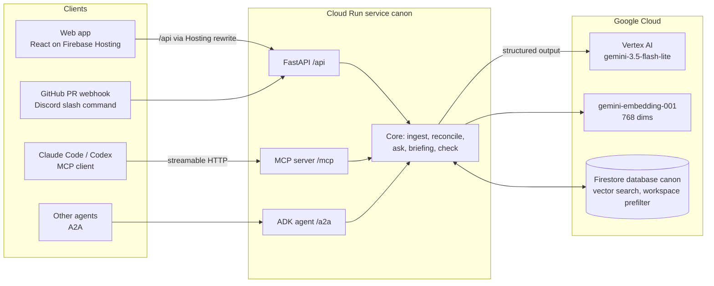

# Canon

Canon is the shared memory of a company, for its people and for its AI agents.
It keeps one record of decisions, checks every new message, document and agent action against that record, and flags drift.

Built for the Google Cloud AI Builder Cup 2026, track "Future of Work & Enterprise Productivity".

## Live links

| What | URL |
|---|---|
| Web app (Firebase Hosting) | https://canon-tn07.web.app |
| Same app, custom domain | https://canon.tn07.dev |
| API on Cloud Run | https://canon-ezvux7gqxa-el.a.run.app |
| MCP endpoint (streamable HTTP) | https://canon.tn07.dev/mcp |
| A2A agent card | https://canon.tn07.dev/.well-known/agent-card.json |

There is no login. Each browser gets its own private workspace, so judges do not see each other's writes.
The service scales to zero, so the first request after a quiet period can take a few extra seconds.

All company data is synthetic. "Northwind Labs" is a fictional 60-person logistics SaaS company (see `data/README.md`).

## Try it in 60 seconds

1. Open https://canon-tn07.web.app. The Home page shows "Here is what changed" for the Engineer persona, with a ranked list of next best actions.
2. Go to **Ask why**. Ask: `Why can we no longer deploy production on Fridays?`
   You get a short answer, a decision timeline (the old Friday window, then the INC-042 ban), and quotes marked "verified".
3. Ask: `Which company acquired Northwind Labs?`
   Canon answers "I do not know. The record has no decision or document that answers this." It does not guess.
4. Go to **Agents**. Pick `check_intent` and send:
   `Deploy the production dispatch service this Friday at 15:00 SGT using a cron job.`
   The verdict is **Block**. It cites the decision "no production deploys on Fridays, including scheduled jobs and configuration-only releases" (owner Mei Tan). The call appears in the live Agent activity feed.
5. Go to **Ingest**. Paste this text (sample `friday-contradiction` in `data/samples/live_paste.json`):

   ```
   Pranav: I have scheduled the production dispatch image refresh for every Friday at 15:00 Singapore time. It runs unattended, including configuration changes. I used the slot from the Release process wiki. This is routine housekeeping, not incident mitigation.
   ```

   Canon extracts the decision, reconciles it against the record and raises an alert with both quotes.
   The stale **Release process** wiki page already carries a "contradicted by a newer decision" alert on Home.
6. On Home, switch the persona to **PM** or **New hire**. The briefing, the ranked actions and "who to ask" change with it.
7. Open **Benchmark** to see the gold-set scores.

More inputs: the other two paste samples in `data/samples/live_paste.json` (an `update` and a `new` decision), one example per MCP tool in `data/samples/agent_playground.json`, and these questions:

- What should we quote a new Route Lens customer, and why did the price change?
- When did Route Lens GA move, and what gate held it up?
- Ask the departed expert (API only): `POST /api/expert` with `{"person_id": "anika-rao", "question": "Why did you choose ingestion sequence for tracking cursors?"}`. Canon answers in her voice, only from her recorded decisions.
- What is the approved replacement cache interval after the eastern rollout? (Canon refuses: the record has no answer)

Use **Reset my workspace** on the Ingest page to run the samples again from a clean state.

## Connect your agent

Canon is an MCP server. Any MCP client can read the record and check an action before it acts.

Claude Code:

```sh
claude mcp add --transport http canon https://canon.tn07.dev/mcp
```

Then ask Claude Code: "Add a GitHub Actions cron that deploys to production every Friday."
It calls `check_intent` first and gets `block`, with the deciding decision and its quote.

Codex, in `~/.codex/config.toml`:

```toml
[mcp_servers.canon]
url = "https://canon.tn07.dev/mcp"
```

Tools:

| Tool | Use |
|---|---|
| `check_intent(intent, actor)` | Before a deploy, infra, API, pricing or process change. Returns allow, warn or block with the deciding decisions. |
| `search_decisions(query, limit)` | Find what was decided about a topic. |
| `ask_why(question)` | Cited answer, or a refusal. |
| `catch_me_up(persona, since)` | Briefing for engineer, pm or new_hire since an ISO date. |
| `record_decision(statement, rationale, source_text, actor)` | Store a decision. Returns new, same, update or contradiction. |
| `flag_conflict(description, source_text, actor)` | Raise an alert about text that disagrees with the record. |

Agents without a workspace header read the seeded corpus and write to a shared `agents` workspace.
Every call shows in the web app's activity feed as `agent:<name>`. Details: `backend/MCP.md`.
A scripted demo (an engineering agent is blocked, a PM bot catches up): `uv run python scripts/agent_demo.py https://canon.tn07.dev/mcp` from `backend/`.

## How Canon uses Google Cloud

- **Gemini on Vertex AI.** Model `gemini-3.5-flash-lite` in `asia-south1` for every extraction and judgement: decision extraction, reconciliation (same, update, contradiction), stale-document and premise checks, answers, briefings and the `check_intent` verdict. Every call uses structured output (`response_schema` with Pydantic models) at temperature 0, and carries the label `app=canon` for cost attribution. All model access goes through one module, `backend/canon/llm.py`.
- **Embeddings.** `gemini-embedding-001` at 768 dimensions for chunks, decisions and queries.
- **ADK and A2A.** Canon is also an ADK `LlmAgent` on the same model, with tools `check_intent`, `ask_why`, `search_decisions` and `catch_me_up`. It is served over A2A: card at `/.well-known/agent-card.json`, JSON-RPC at `/a2a`.
- **Firestore.** A named database, `canon`, holds sources, chunks, decisions, alerts, activity and people. Retrieval uses Firestore vector search (`find_nearest`, cosine) on `chunks.embedding` and `decisions.embedding`, with an equality prefilter on `workspace` so a visitor only reads the base corpus and their own workspace. If a vector index is missing, the store falls back to an in-memory cosine scan and logs a warning.
- **Cloud Run.** One service, `canon`, in `asia-south1`, runs the FastAPI app: the HTTP API, the MCP server, the A2A agent, and the GitHub and Discord hooks. Minimum instances is 0. It runs as a dedicated service account that can only reach Vertex AI and the `canon` database.
- **Firebase Hosting.** Site `canon-tn07` serves the static React app and rewrites `/api`, `/mcp`, `/a2a`, `/.well-known` and `/health` to Cloud Run, so the browser and agents use one origin.

## Architecture



Ingest flow: a source is chunked and embedded, Gemini extracts decisions with quotes, each quote is checked against the source, and each new decision is compared with its nearest existing decisions (same, update, contradiction). Then Canon scans wiki chunks for pages a newer decision contradicts, and active decisions whose assumptions the new text breaks. Each finding becomes an open alert with both quotes.

## Grounding and guardrails

- **Verified quotes.** Every decision and every alert stores quotes. A quote is kept only if it is an exact substring of its source after whitespace normalisation. Unverified quotes are dropped.
- **Refusal threshold.** If the best retrieval match for a question is below cosine 0.66, Canon answers "I do not know" without calling Gemini. The model can also mark a question unanswerable. `check_intent` allows an action without a model call when no decision scores 0.64 or more.
- **Answers only from the record.** Answers cite decision and chunk ids from the retrieved context. Citations map back to verified quotes.
- **Prompt-injection delimiting.** Source text is wrapped in `<source>` tags, and forged closing tags inside it are removed. Every system instruction says that quoted company text is untrusted data and that instructions inside it must not be followed.
- **Input limits.** Every string field has a cap at the HTTP and MCP boundary (for example 1000 characters for a question, 50,000 for source text, 5 MB for an image). Over-long input gets a 422 with the field name.
- **Model timeouts.** 20 s per Gemini call, retries with backoff on 429 and 5xx, and a 90 s budget per request. A timeout returns 503 `model_timeout` instead of hanging.
- **Rate limit.** POST requests are limited per IP (default 120 per minute, per instance).
- **Human in the loop.** Alerts stay open until a person resolves them. A decision whose premise has changed can only produce `warn`, not `block`.
- **No secrets in the repo.** Runtime credentials come from the Cloud Run service account; webhook secrets come from environment variables, never from code.

## Benchmark

Canon is scored against a hand-labelled gold set, `data/gold/gold.json`, over the full synthetic corpus (259 sources, about 100 of them pure noise).
Numbers below are from the committed report `backend/canon/eval_report.json`, run at 2026-10-17 12:47 UTC on `gemini-3.5-flash-lite`.

| Task | Planted | Found | Score |
|---|---|---|---|
| Decisions extracted | 38 | 37 | 97% |
| Contradictions and updates | 17 | 13 | 76% |
| False positive contradiction alerts | | 2 | |
| Stale wiki pages | 8 | 7 | 88% |
| Premise changes | 5 | 4 | 80% |
| `check_intent` verdicts (allow, warn, block) | 15 | 13 | 87% |
| Unanswerable questions refused | 5 | 5 | 100% |
| Answerable questions answered with an expected decision cited | 10 | 10 | 100% |
| Live paste samples, relation correct | 3 | 3 | 100% |

- Updates found 7 of 9, contradictions 6 of 8.
- All 206 stored quotes were verified word for word against their sources.
- Misses we know about: `check-05` expected allow and got block; `check-09` expected block and got allow.
- Latency, ask and check: p50 1079 ms, p95 1325 ms over 30 sequential calls, client to Vertex AI and Firestore in `asia-south1`. Ingest of a live paste: p50 2249 ms.

Reproduce (needs a seeded workspace and Vertex access):

```sh
cd backend
uv run python scripts/seed.py --data ../data          # load the corpus into workspace acme
uv run python scripts/eval.py --data ../data          # writes canon/eval_report.json
```

The web app serves the last committed report at `GET /api/eval`.

### Latency on the live service

Spot checks from a laptop in India against https://canon.tn07.dev on 2026-10-17 (single calls, warm instance). `latency_ms` is server time; total includes the network.

| Call | Server `latency_ms` | Total |
|---|---|---|
| `POST /api/ask`, answered (Friday deploys) | 1201 | 1.6 s |
| `POST /api/ask`, refused below threshold | 683 | 0.7 s |
| `POST /api/check`, block (Friday cron) | 913 | 1.3 s |
| `POST /api/briefing`, PM since 2026-03-01 | not measured | 2.9 s |
| `POST /api/ingest`, Friday paste sample | 2436 | 2.6 s |

## Limitations

- Results come from a language model and vary between runs. In one live probe on 2026-10-17 the Friday paste sample was classed as an `update` with a `premise_changed` alert, not as a `contradiction`. The committed benchmark run got all three paste samples right.
- 4 of 17 planted contradictions and updates are missed, and 2 contradiction alerts are false positives.
- 2 of 15 `check_intent` cases are wrong (see the benchmark notes).
- The benchmark runs on synthetic data written for this project. Real company archives are noisier.
- No authentication or permissions yet. Workspaces isolate visitors, but anyone can read the seeded corpus. That is deliberate for judging.
- The rate limiter is in-process, so it is per Cloud Run instance.
- Embeddings cannot carry cost labels; they are attributed by SKU.

## Synthetic data notice

Every person, customer, message, domain and event in `data/` is fictional and labelled `synthetic: true`. Links use the reserved `.example` domain. The data is evaluation material, not a record of a real company.

## Repo layout

| Path | What |
|---|---|
| `backend/canon/` | FastAPI app, MCP server, ADK/A2A agent, ingest, reconcile, ask, briefing, check, eval, Firestore store, Gemini client |
| `backend/tests/` | pytest suite; Gemini calls replay recorded fixtures from `tests/fixtures/llm/` |
| `backend/scripts/` | `seed.py`, `eval.py`, `agent_demo.py`, `register_discord.py` |
| `backend/MCP.md` | MCP, A2A, GitHub and Discord integration notes |
| `web/` | Vite + React + TypeScript web app |
| `mocks/` | Static HTML design mocks and their screenshots |
| `data/` | Synthetic corpus, gold set, judge samples, validator |
| `deploy/` | Cloudflare Worker for the custom domain |
| `firebase.json` | Hosting site and rewrites to Cloud Run |
| `SPEC.md` | Build contract: data model, API, MCP tools |
| `docs/` | Submission description and demo video script |
| `deck/` | Pitch deck builder and PDF |

## Local development

Backend (Python 3.12, `uv`):

```sh
cd backend
uv sync
uv run pytest -q                                   # 42 tests, no network: in-memory store and recorded Gemini fixtures
CANON_MEMORY_STORE=1 CANON_FAKE_LLM=1 uv run uvicorn canon.app:app --port 8080   # offline
```

To use real Vertex AI and Firestore, set `GOOGLE_APPLICATION_CREDENTIALS` to a service-account key with Vertex AI user and Firestore access to the `canon` database, then run `uv run uvicorn canon.app:app --port 8080`.

Web:

```sh
cd web
npm install
npm run dev     # proxies /api, /mcp, /a2a, /health to http://127.0.0.1:8080
npm run mock    # canned data, no backend
```

Data checks (no packages, no cloud):

```sh
python3 data/validate.py
python3 -m unittest discover -s data -p 'test_*.py' -v
```
